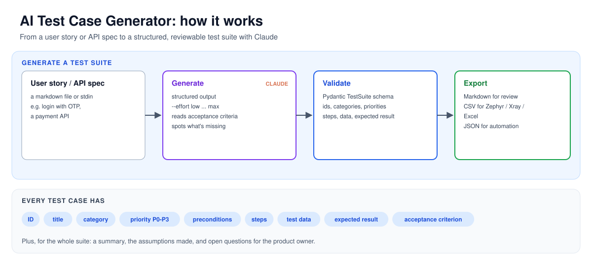
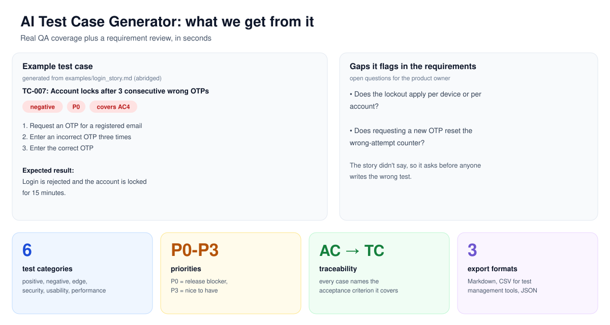

# 🧪 AI Test Case Generator

Turn a **user story or API spec** into a **structured, executable test suite** in seconds, using Claude.

Built by a QA engineer, for QA engineers: it doesn't just list happy paths. It covers negative, edge and security cases, ties each case to an acceptance criterion, and **flags the gaps in your requirements** as open questions for the product owner.

## How it works



## What we get from it



## ✨ Features

- **Structured output, not free text.** Every response is validated against a Pydantic schema, so you always get IDs, priorities, steps, test data and expected results.
- **Real QA coverage.** Positive, negative, edge, security, usability and performance categories, with P0–P3 priorities.
- **Traceability.** Each case records which acceptance criterion it covers.
- **Requirement review built in.** Assumptions and open questions show what the story didn't say.
- **Ready for test management tools.** CSV export imports into Zephyr, Xray or Excel.
- **Adjustable depth.** `--effort low` for a quick pass, `--effort high` for critical features.

## 🚀 Quick start

```bash
git clone https://github.com/abpandey-dev/ai-testcase-generator.git
cd ai-testcase-generator
python3 -m venv .venv && source .venv/bin/activate
pip install -r requirements.txt
export ANTHROPIC_API_KEY="your-key"   # from console.anthropic.com
```

Generate a test suite:

```bash
python -m testgen examples/login_story.md
python -m testgen examples/payment_api.md --format csv --out payment_tests.csv
cat my_story.txt | python -m testgen - --format json
```

| Option | Values | Default |
|---|---|---|
| `-f, --format` | `md`, `csv`, `json` | `md` |
| `-o, --out` | file path | stdout |
| `--effort` | `low`, `medium`, `high`, `xhigh`, `max` | `medium` |

## 📄 Example output

From [`examples/login_story.md`](examples/login_story.md) (abridged):

```markdown
## TC-007: Account locks after 3 consecutive wrong OTPs
**Category:** negative · **Priority:** P0

**Steps**
1. Request an OTP for a registered email
2. Enter an incorrect OTP three times
3. Enter the correct OTP

**Expected result:** Login is rejected and the account is locked for 15 minutes.
**Covers:** AC4

## Open questions
- Does the lockout apply per device or per account?
- Does requesting a new OTP reset the wrong-attempt counter?
```

## 🗂️ Project structure

```text
testgen/
  models.py      # Pydantic schema: TestSuite, TestCase
  generator.py   # Claude call with structured output + error handling
  exporters.py   # Markdown, CSV and JSON renderers
  cli.py         # Command-line interface
examples/        # Sample user story and API spec
docs/            # how-it-works and what-we-get diagrams (SVG)
tests/           # Offline unit tests (no API key needed)
```

## 🧪 Running the tests

```bash
pytest
```

The tests stub out the Claude call, so they run offline and for free.

## 🛣️ Roadmap

- [ ] Generate runnable code: pytest + requests, Rest Assured, Selenium
- [ ] Coverage scoring: an LLM-as-judge eval that rates suites against a rubric
- [ ] Read requirements straight from Jira
- [ ] Simple web UI

## 🛠️ Tech

Python · Anthropic Claude API (structured outputs) · Pydantic · pytest
